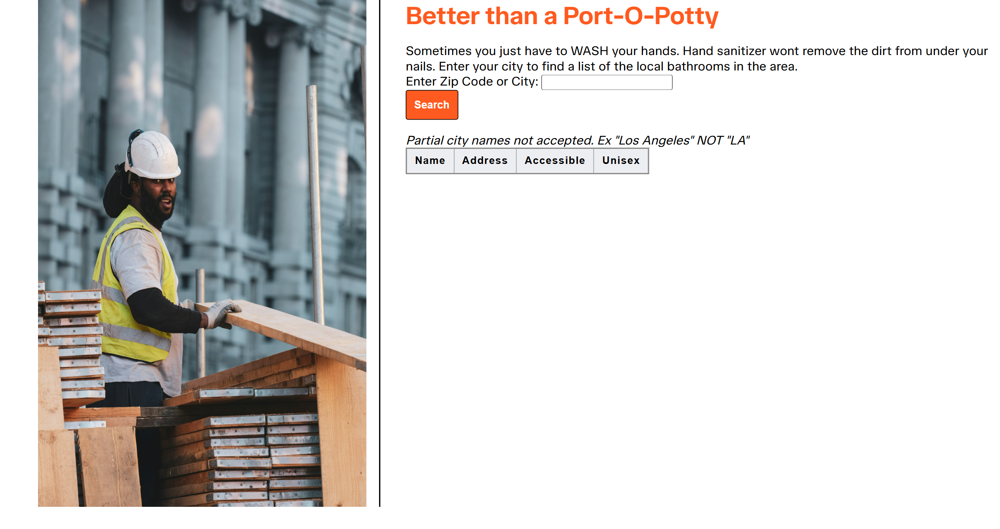

# 🏗️ Better-than-a-Port-O-Potty

## Project Description

Better-than-a-Port-O-Potty is A helpful web app for construction workers that searches for bathrooms in the area. Users check for public restrooms in their area by searching their city or ZIP code. It uses the Geocod.io API to convert a ZIP code into geographic coordinates, then sends those coordinates to the www.refugerestrooms.org/api/ API to retrieve restrooms in the area. It also lists if the restroom is considered Accessible and Unisex. 

"Sometimes you just have to WASH your hands. Hand sanitizer wont remove the dirt from under your nails!"

### How It's Made:
Tech used: HTML, CSS, JavaScript

## How to Run or View It

1. Clone or download the repository.
2. Open `index.html` in a browser or serve the project using a local development server.
3. Enter a US city or ZIP code in the search field.
4. Click **Search** to retrieve geographic coordinates and list of local restrooms
5. Review the displayed restroom, address, accessibility attribute, and unisex attribute.

The application requires an internet connection to access its external APIs. API availability and credential requirements may affect the results.

## Screenshots and Demo

### Application Interface

.png)

The interface includes a ZIP-code search field, a list of local restrooms and if the restroom is considered Accessible and Unisex. 

### Lessons Learned:
This project really highlighted the difficulty of matching your desired input with the available parameters for the API. For instance the geocoding url for the initial input doesn't neatly allow city and state to be entered. 
